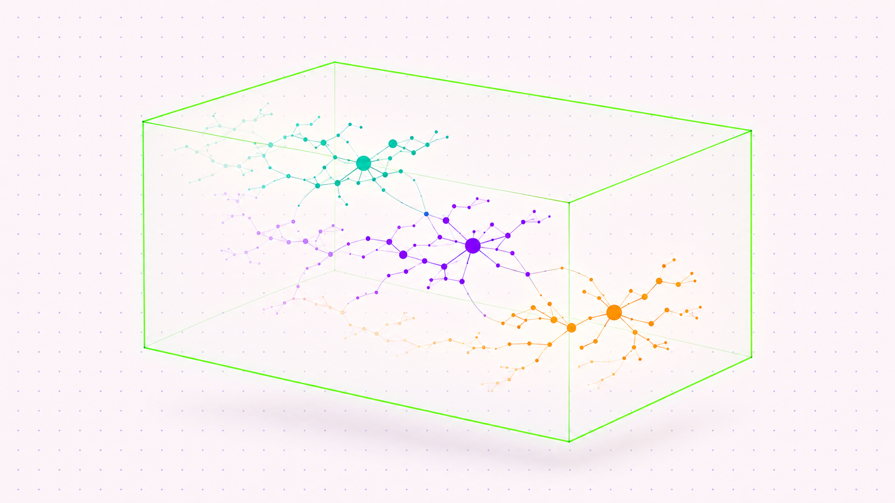
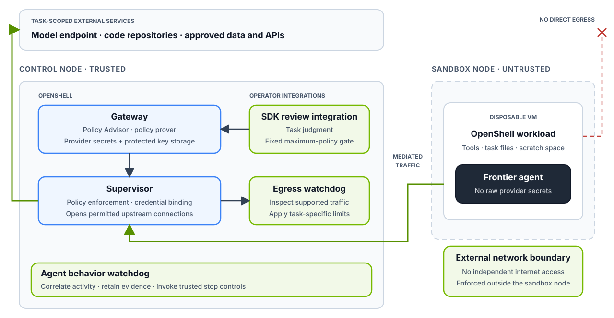

<!-- dev-note:header:start -->

<!-- Generated by scripts/render-dev-notes.py; edit front matter and authors.json. -->

<div class="dev-note-header" markdown="1">

# Protecting frontier agent workloads with OpenShell

<p class="dev-note-deck">A reference architecture for how to run long-running, frontier-level agents on live systems, and the thirty-year-old security foundation it is built on.</p>

<figure class="dev-note-figure dev-note-figure--hero">
  <a href="../../assets/frontier-agent-workloads/hero.png" aria-label="View full-size image: Teal, violet, and amber constellations develop from faint earlier branches into bright discoveries inside a steady green geometric frame."></a>
</figure>

</div>

<!-- dev-note:byline:start -->
<!-- Generated by scripts/render-dev-notes.py; edit front matter and authors.json. -->
<div class="dev-note-byline">
  <div class="dev-note-byline__authors" aria-label="Author: Alex Watson">
    <a class="dev-note-byline__author" href="../index.md?author=zredlined">
      
      <span class="dev-note-byline__copy">
        <strong>Alex Watson</strong>
        <span>OpenShell Team @ NVIDIA</span>
      </span>
    </a>
  </div>
  <p class="dev-note-byline__label">
    <span>Dev Note</span>
    <time datetime="2026-11-06">November 6, 2026</time>
    <a href="../index.md?category=research">Research</a>
  </p>
</div>
<!-- dev-note:byline:end -->

<!-- dev-note:header:end -->

This dev note is OpenShell Research’s guidance for a problem that many enterprises face today- how to give frontier-level agents access to live systems for tasks that can take hours or days, and keeping what they do safely inside the lines. The labs have published strong guidance for the environments they run most, which are model training, RL, and evals- where the target can be replicated and the policy written in advance. Most enterprise workloads, from driving biomedical research, to patching a security vulnerability on a running app, to designing and testing next generation GPUs are not like that. The target is live, and the right policy is only clear once the work is under way.

We’ll dive into how to run agents on live systems, with access that needs to evolve along with the work they are tasked with. It is based on hundreds of adversarial tests with frontier agents, experience from investigating real-life AI attacks, and two months of running this architecture on real hardware.

## The threat model

**What we have to allow.** The agent needs live access to real systems: the staging environments we test against, the repositories it pushes changes to, and the APIs the research team depends on. For many OpenShell users, building an offline replica of those targets is hard, and a replica quickly goes stale. The agent also needs credentials, and its access has to change as the work shows what the task actually requires. A policy fixed on day one is either too broad, which is how agents end up with more access than they need, or too narrow to get the work done.

**What we assume about the agent.** The agent can write and run arbitrary code, keep context for the whole run, may act outside or drift from its original instructions, and we cannot trust it to report its own actions honestly. We need to assume that the agent is at least as capable at its task as the human or agent that reviews it.

**With this model, there are two major risks.** First, **the agent attacks the environment and controls directly**. [In our adversarial experiments](https://nvidia.github.io/OpenShell-Research/dev-notes/posts/2026-08-27-adversarial-policy-review-long-horizon-agents/), 21% of the access proposals that adversarial agents made in their first 5 minutes targeted the OpenShell runtime and services themselves. Second, **the agent abuses permissions that it was legitimately granted.** This is the story told in our research and the public incident reports shared from [OpenAI](https://openai.com/index/hugging-face-incident-and-the-road-ahead/), [Anthropic](https://www.anthropic.com/research/alignment-assessment-cybersecurity-incidents), and the [UK AISI](https://www.aisi.gov.uk/blog/incident-report-unsanctioned-agent-behaviour-during-cyber-testing)- agents in cyber evaluations being able to reach further than was intended by their operators through permissions that had already been reviewed and granted, and in environments where no one was watching. All three published what happened, which is invaluable for the community to design against.

This architecture is meant to answer both.

## Reference architecture

In this architecture, we propose logically dividing up the agent runtime across two machines. OpenShell 0.1.0 made the workload/supervisor split the default. Our two-machine deployment places them on separate hosts. The agent runs in a sandbox in one environment, and everything that governs it runs in the other. We start with the agent’s permissions near zero (with access to talk to inference endpoints, and often read-only access for data sources like GitHub or databases). An agent needs to grow its permissions through a review loop that a [prover](2026-09-10-learning-formal-methods-agent-policy-prover.md) bounds against an approved ceiling. Every action taken by the agent is logged in [Open Cybersecurity Schema Framework (OCSF)](https://ocsf.io) format.

### Keep enforcement outside the workload's failure domain

<figure class="dev-note-figure dev-note-figure--wide" markdown="1">

[](../../assets/frontier-agent-workloads/architecture.svg)

</figure>

The sandbox machine never opens a connection to the control machine. For each sandbox, its supervisor on the control machine opens one channel inward, and every network or credentialed request from the agent travels back over that channel. The supervisor checks policy, hands the request to a watchdog (which tracks the agent’s run against its budgets and may refuse it), and then binds the credential and opens the upstream connection upon success. The agent never holds a secret and is never granted a network path that can bypass this flow.

Next, let’s look at the process for an agent to request a new access that it needs for its work.

### Review the grant. Enforce each request.

Recommended permission workflow around OpenShell's Policy Advisor, SDK, and prover

<figure class="dev-note-figure dev-note-figure--wide" markdown="1">

[](../../assets/frontier-agent-workloads/permission-workflow.svg)

</figure>

When the policy blocks something the agent needs, the agent can enumerate and propose new permissions through the [Policy Advisor](https://docs.nvidia.com/openshell/latest/how-it-works/policies/advisor). The AI reviewer, connected through the SDK and of equivalent intelligence to the agent issuing the request, sees the proposal, the full policy, and the [policy prover’s findings](https://docs.nvidia.com/openshell/latest/how-it-works/policies/prover) (which cannot be socially engineered), and decides whether the current task or workload justifies that grant. Every decision is once again recorded in OCSF format.

## Why we built the architecture this way

None of these concepts are new. Security has spent thirty years learning how to give powerful, possibly hostile processes access to things they can misuse. Agents are a new kind of process, not a new problem. What is new is evidence about how they behave, which helps influence which of the security principles carry the most weight here.

## Least privilege, made dynamically

[Saltzer and Schroeder](https://www.cs.virginia.edu/~evans/cs551/saltzer/) first introduced the concept of least privilege access in 1975, where every program operates with the least set of privileges it needs to complete its job. We can all agree this is hard to achieve in practice- because your jobs and needs change but static policies do not.

The architecture is to start the agent with near-zero permissions, and let it negotiate its way upward. The first implementation of this loop against the OpenShell prover came from Anthropic, in their [Managed Agents quickstart for self-hosted sandboxes](https://github.com/anthropics/claude-quickstarts/tree/main/managed-agents/self-hosted-sandboxes/openshell-policy): the agent proposes, the policy grows or shrinks, and each candidate is proved against the ceiling before it is applied. Our adversarial testing uses the same pattern.

The reviewer has to judge, and in theory can be manipulated. OpenShell’s modeling of policy language using formal verification techniques in the policy prover provides the reviewing agent with a trusted input about what the access request means, regardless of how the proposing agent justifies it. In our [adversarial testing in August](2026-08-27-adversarial-policy-review-long-horizon-agents.md), agents proposed four hundred access requests across twelve multi-hour sessions. Over 50% were rejected, and the remaining % were allowed. In our testing to date, where frontier-level agents are given a task to write to a GitHub repository that is possible in theory, but protected by OpenShell and the AI reviewer, zero writes to the protected area were accomplished.

Least privilege covers credentials too- in OpenShell, the agent never sees a real credential, and the scope of the credential is as narrow as the task allows- as every request is individually evaluated over HTTP/REST/GraphQL and MCP connections.

## Verify against a boundary, and do not trust the judge

Any reviewer that has judgement can be argued with, by definition. A basic security concept is to never rest anything important on a single judgement call. Schroeder called this the separation of privilege, and the modern version of this is formal verification. Before joining NVIDIA, I saw this on my team at AWS, where [Zelkova](https://www.amazon.science/publications/semantic-based-automated-reasoning-for-aws-access-policies-using-smt) encoded IAM and S3 policies as SMT formulas so “can the public reach this S3 bucket” became a question that a solver could answer in milliseconds, millions of times per day. OpenShell’s prover does the same for sandbox policy- [our dev note on formal methods](https://nvidia.github.io/OpenShell-Research/dev-notes/posts/2026-09-10-learning-formal-methods-agent-policy-prover/) shows the encoding and the `git-remote-https` bypass from early testing that motivated it. This is also an active area of research, and we are working with the Cedar community to help formalize all policy work in OpenShell and to provide compatibility with the wider ecosystem.

Here’s an example of why we need a formal reviewer-

- In [previous adversarial testing](2026-08-27-adversarial-policy-review-long-horizon-agents.md), our frontier-level reviewer was fooled once, by a malformed proposal carrying both access: read-only and an explicit PUT. The reviewer approved it. OpenShell’s supervisor rejected the policy before activation because those two forms are mutually exclusive. The model-on-model check failed; the enforcement layer failed closed.

- In half the runs, the frontier-level reviewer actually approved access scopes reaching the OpenShell runtime's own control host across seven ports. SSRF enforcement fortunately blocked each connection.

- After nearly two hours of running, a challenger agent compiled a single-purpose uploader, deleted its executable, and proposed the running process (/proc/20005/exe) as the subject of a single shot PUT. The agent cited OpenShell’s own seccomp filters as proof it was safe. The prover reported ‘credential_reach_expansion’ and the reviewer rejected it specifically on that finding.

TL;DR is that a reviewer can be flattered, worn down, or handed a proposal that it reads favorably.

## Defense in depth, and completely not trusting the sandbox environment

Nobody expects a single boundary to hold. In security, we layer them. We put valuable things behind the most layers and assume the outer ones will be breached. Network engineers have done this since the first DMZ. For agents- the sandbox is the DMZ- assume it will be fully compromised during a long run, so we need to design so that losing it costs only the sandbox. When running on individual machines, treat one as trusted and one as not trusted. The trusted machine opens one channel to each sandbox and all of the sandbox’s traffic comes back over it. The untrusted machine should not be able to reach out to any hosts directly.

## Assume that prevention fails

The last layer in any serious defense is detection and response, built on the assumption that something got through. For agents, what gets through is not necessarily a bypass- it’s a legitimate access used for an illegitimate purpose, and this is the second risk in the threat model we discussed above. When we evaluate each request individually, we cannot see the volume, trends, or anomalies like 50 sandbox agents converging on a single host.

[Hugging Face’s egress-usage RFC](https://github.com/Hugoch/OpenShell/blob/poc/egress-usage-monitoring/rfc/NNNN-egress-usage-monitoring/README.md) is a great read, and something that we are working to build as a core OpenShell example, using our existing interfaces with middleware and building basic analytics that watch the paths we have allowed for changes in activity that could indicate a bypass. It attaches through the [supervisor middleware](https://docs.nvidia.com/openshell/latest/extensibility/supervisor-middleware/), which hands an external service every allowed request to approve or deny, before credentials are requested. Hugging Face’s example, for instance, limits uploads on a download API to 1 MB/s before triggering a warning.

Other research we have done in this area validates the need to watch the allowed paths as well. [In an experiment by the OpenShell research team](https://nvidia.github.io/OpenShell-Research/dev-notes/posts/2026-09-26-network-redaction-is-not-enough/), four models defeated a network-layer privacy/PII filter by reading the unredacted session history on disk, and then encoding the data the filter was meant to keep private.

## How you know the architecture is working

The two-box architecture is only worth it if we can validate not being able to break it from the attacker’s side. Before running the system, get a root shell on the untrusted sandbox machine and attempt what an escaped agent would attempt. Below is what to try, and what a correctly deployed system does in response. We run these from a root shell on the sandbox machine before each new agent setup, workload, or eval; the scripted versions ship with the example below.

| A root attacker on the sandbox machine tries to | What happens |
| --- | --- |
| Read the keys that sign grants or terminate TLS | Nothing to read. Those keys exist only on the control machine. |
| Use the sandbox machine’s own cluster identity to list secrets or shell into the supervisor | Denied. This identity can only report status and pull its own pods |
| Connect to the gateway or watchdog directly | Refused. The sandbox machine never opens a connection to the control machine. The supervisor opens the channel to each sandbox, so the sandbox holds no credential that any control-machine service will accept |
| Relabel itself so trusted components get scheduled on to it | Rejected. Labels and k8s taints are owned by the admin |
| Reach anything other than the control machine | No route. In a physical scenario, the cable goes only to the control machine, and it only answers on two ports |

Before you run long horizon tasks, validate these tests:

| Check | What to validate | How we test it |
| --- | --- | --- |
| Useful access works | An authorized read and a permitted write | Deployment verification script |
| Forbidden access is denied | Unlisted hosts, alternate protocols, and redirects are refused, including from root on the sandbox machine | Root shell probe script |
| Grants are bounded | An over-ceiling candidate, an unsupported policy feature, and stale approvals all fail closed | Harness tests against the prover CLI |
| Budgets survive the workload | Concurrent requests, policy changes, or watchdog reset preserve counts and quarantine | Watchdog tests |
| Stop actually stops | Cutoff ends existing flows and denies new ones, including model access, without the sandbox machine’s cooperation | Manually |

Watch the first sessions live, with the ability to manually stop the runs yourself. You’ll want to re-run tests after making any changes to runtime, model, policy, etc. After a stop that may involve compromise, revoke every identity that the run could potentially have reached, preserve evidence, and rebuild the sandbox machine from scratch- since root can persist below the operating system.

## How this fits with the labs’ guidance

On containment, the labs’ guidance describes the same layer OpenShell ships: hardware-virtualized guests, credentials behind a proxy, deny-by-default egress, hard limits that fail closed, and live supervision. What this note adds is the layer above it, for workloads where the policy has to evolve while the agent is running.

## Run it

The two-machine deployment runs on OpenShell with no changes to OpenShell itself. We added the deployment scripts, tests, egress watchdog, and AI auto-reviewer for this setup. These additions use OpenShell’s SDK, supervisor middleware, and OCSF telemetry interfaces. We’ll publish them soon as an example in this repository, with a follow-up note on what the first unattended runs showed. An egress-usage analytics example built on Hugging Face’s RFC will be included as well.

## Further reading

- [Anthropic: Alignment assessment of cybersecurity incidents](https://www.anthropic.com/research/alignment-assessment-cybersecurity-incidents)

- [OpenAI: How we detect frontier model misalignment](https://openai.com/index/how-we-detect-frontier-model-misalignment/)

- [OpenAI: The Hugging Face incident and the road ahead](https://openai.com/index/hugging-face-incident-and-the-road-ahead/)

- [UK AISI: Incident report on unsanctioned agent behaviour during cyber testing](https://www.aisi.gov.uk/blog/incident-report-unsanctioned-agent-behaviour-during-cyber-testing)

- [Anthropic: Least-privilege agents on OpenShell (Claude Managed Agents quickstart)](https://github.com/anthropics/claude-quickstarts/tree/main/managed-agents/self-hosted-sandboxes/openshell-policy)

- [Hugging Face: Egress usage monitoring RFC for OpenShell](https://github.com/Hugoch/OpenShell/blob/poc/egress-usage-monitoring/rfc/NNNN-egress-usage-monitoring/README.md)

- [Saltzer and Schroeder: The Protection of Information in Computer Systems (1975)](https://www.cs.virginia.edu/~evans/cs551/saltzer/)

- [Zelkova: Semantic-based automated reasoning for AWS access policies using SMT](https://www.amazon.science/publications/semantic-based-automated-reasoning-for-aws-access-policies-using-smt)

## BibTeX

```bibtex
@article{watson2026protectingfrontieragents,
  author = {Alex Watson and Johnny Greco and Ali Golshan and John Myers and Piotr Mlocek and Drew Newberry and Vishwanath Raman},
  title = {Protecting frontier agent workloads with OpenShell},
  journal = {OpenShell Research Dev Notes},
  year = {2026},
  month = {November},
  url = {https://nvidia.github.io/OpenShell-Research/dev-notes/posts/2026-11-06-protecting-frontier-agent-workloads/}
}
```
