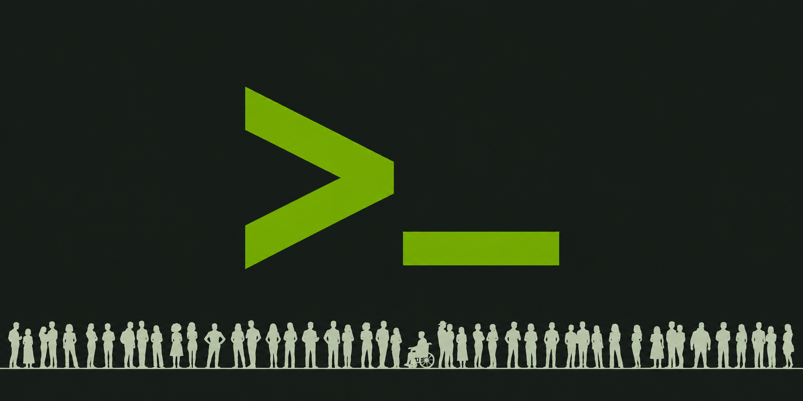

<!-- dev-note:header:start -->

<!-- Generated by scripts/render-dev-notes.py; edit front matter and authors.json. -->

# OpenShell is now a CNCF Sandbox project

<figure class="dev-note-figure dev-note-figure--hero">
  
  
</figure>

<!-- dev-note:byline:start -->
<!-- Generated by scripts/render-dev-notes.py; edit front matter and authors.json. -->

  

    <a class="dev-note-byline__author" href="../index.md?author=openshell-team">
      
      
        <strong>OpenShell Team</strong>
      
    </a>
  

  

    Dev Note
    <time datetime="2026-11-09">November 9, 2026</time>
    <a href="../index.md?category=announcements">Announcements</a>
  

<!-- dev-note:byline:end -->

<!-- dev-note:header:end -->

Today, NVIDIA is contributing OpenShell, the open source runtime to secure and govern autonomous AI agents, to the Cloud Native Computing Foundation (CNCF) as a Sandbox project. OpenShell gives agents real capability in problem solving, without giving them unrestricted access to data, secrets, or networks.

NVIDIA built OpenShell with the understanding that policies and enforcement cannot meaningfully occur in agent prompts and harnesses as those are probabilistic and do not provide a secure deterministic safety perimeter. OpenShell provides that deterministic enforcement layer to secure and govern fleets of autonomous agents. It provides a Gateway to manage agent lifecycles, a Supervisor to enforce policies and secure communication to sandboxes that isolate agent workloads, credential brokering to ensure agents never see credentials, and OCSF event streams to observe and audit agent behaviors. OpenShell is adopting Cedar, a CNCF project, as its policy language, giving teams a proven, auditable framework with a formal verification model rather than natural language instructions that agents can misinterpret or circumvent.

Engineers from Red Hat, Docker, and Canonical joined as maintainers from early on, as an affirmation of the OpenShell thesis, and a demonstration of the value of deterministic controls for agent safety and governance. Moving OpenShell to CNCF puts that capability under neutral, community-led governance, similar to other industry-changing CNCF projects such as Kubernetes, Envoy, Prometheus, OpenTelemetry, gRPC, Helm, and others.

## Extensibility by design

OpenShell is built on the principle that no two agent deployments are alike. Compute infrastructure, secret stores, inference providers, and governance models vary across organizations and evolve over time. Rather than prescribe a stack, OpenShell defines clean interfaces at every layer so teams can bring what they already operate.

- **Providers** to connect your APIs and inference endpoints
- **Drivers** to bring your compute, from VMs to Kubernetes
- **Gateway interceptors** to plug in your governance and approval flows
- **Middleware** to extend policy enforcement at the Supervisor layer
- **Isolation backends** to bring your preferred sandbox or workload isolation primitive
- **Credential drivers** to integrate your secret storage and management

Each interface is designed to be independently extensible, so you can adopt OpenShell incrementally and swap components as your infrastructure matures.

## Why CNCF

The OpenShell maintainers are the community that includes engineers from NVIDIA, Red Hat, Docker, and Canonical, who have worked on OpenShell across the runtime, SDKs, and documentation. The project adopted the CNCF Code of Conduct, has a public RFC process, and a governance model with explicit vendor-neutrality commitments.

Agents are becoming cloud native infrastructure and belong in the cloud native ecosystem. The infrastructure that secures and governs these agents should therefore be part of CNCF and remain a community-driven asset without affinity to any specific vendor. Hosting OpenShell under the aegis of CNCF guarantees that no single organization controls the project’s direction or release decisions.

## What changes, what doesn’t

OpenShell is moving from NVIDIA’s GitHub repository to a neutral GitHub organization, ai-openshell. Components such as SDKs, drivers, and installation tooling may move into dedicated repositories under the same organization, each with its own maintainer team. We’ll form working groups and special interest groups for deeply integrated components like drivers, and for cross-cutting concerns like observability.

NVIDIA’s engineering and research investment doesn’t change. The core maintainer team stays on as core developers and keeps adapting OpenShell to the changing AI landscape.

## Where we’re headed

We’re migrating repositories and expanding the maintainer ecosystem. As a CNCF Sandbox project, we’re organizing community teams and building a public roadmap.

Sandbox is a stage, not a destination. Our near-term goal is CNCF Incubation, which requires:

- Maintainers from more organizations.
- Documented and practiced governance.
- Release and security discipline suited to critical workloads.

Several of these are already in motion. We invite the community to be stewards of OpenShell, jointly maintaining and contributing to make it into a robust ecosystem.

## How to contribute

If your organization already uses OpenShell, contributing is the fastest way to shape where it goes. Here are concrete ways to start.

1. **Build or harden an extension implementation.**

    Pick the extension point closest to your stack and contribute a reference implementation, or improve an existing one. Examples include compute drivers for your scheduler or preferred cloud, credential drivers for secrets management, providers for inference, and logging exporters for your preferred observability pipelines.

    Each interface should ship with documentation and a conformance test suite so third-party implementations behave consistently. Contributing to those suites is a high-leverage way into the OpenShell ecosystem.

2. **Write policy and enforcement logic.**

    Build middleware or Gateway interceptors that encode real governance requirements, such as egress allowlists, tool-call approval flows, and per-tenant policy. Share them as examples or as a policy library. Gaps you find in the interface while doing this are valuable feedback, so file them as issues or design proposals.

    We would welcome your feedback on the Cedar policy framework and proposals for extensions that make authoring policies easier. Cedar also provides the foundation for temporal policy extensions on our roadmap.

3. **Extend isolation backends and platform coverage.**

    Help with Linux, macOS, and Kubernetes parity, including new isolation primitives, hardened defaults, and the security review that comes with them. Threat modeling and adversarial testing of sandbox escapes are especially welcome.

    OpenShell is extending deeper into infrastructure components, including confidential computing capabilities that are vendor-agnostic. Building or extending existing drivers to take advantage of confidential computing for agent workloads will be a great starting point. We are concurrently working on enabling running of OpenShell services within confidential computing environments to assure integrity of the OpenShell Gateway and Supervisor. We welcome your contributions to these hardening capabilities.

4. **Improve observability.**

    Help define consistent metrics, traces, and structured audit events across the Gateway, drivers, and sandboxes, aligned with OpenTelemetry. Real-time security monitoring depends on a schema everyone can rely on.

5. **Own packaging and release engineering.**

    Maintain packages for common package managers, reproducible builds, SBOMs, signing, and CI. This directly supports the release and security discipline Incubation requires.

6. **Take on enterprise requirements.**

    Contribute to multi-tenancy, authN/authZ integration (OIDC, RBAC), and policy-management workflows, using the use cases you see in your own deployments.

## Get involved

- Join the [mailing list](https://groups.google.com/a/ai-openshell.org/g/openshell-community/about) for community notes and call invites.
- Find us in the [CNCF Slack channel #openshell-dev](https://slack.cncf.io/).
- Watch the [ai-openshell GitHub organization](https://github.com/ai-openshell) for new repositories, “good first issue” labels, and design proposals.
- Watch for working groups and SIGs, which will form around drivers, security, observability, and other areas. Join the one that matches your use case.

We welcome contributors, end users, and people who are both.
