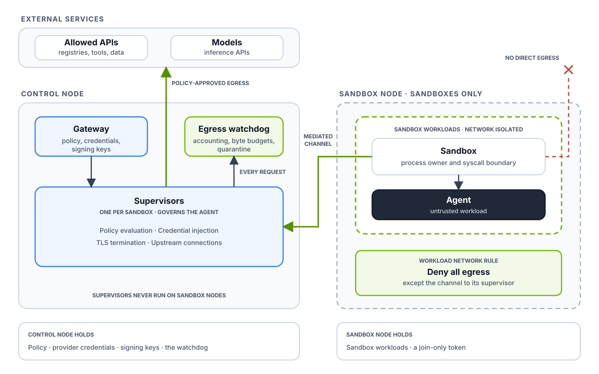

# Agent containment

Machine-isolated agents with egress usage monitoring.

Capable agents probe their own runtime first, then abuse whatever access their
policy allows. This example puts everything that governs an agent on a machine
the agent cannot reach, and watches the traffic its policy already allows.

- **The control node** runs the OpenShell gateway, every sandbox's
  supervisor, and an egress watchdog that enforces byte budgets on allowed
  hosts.
- **A sandbox node** runs sandbox workloads and nothing else. Add more
  sandbox nodes the same way.

This deployment pattern is often called *two-box*. The egress usage
monitoring builds on Hugging Face's proof of concept and
[RFC](https://github.com/Hugoch/OpenShell/blob/poc/egress-usage-monitoring/rfc/NNNN-egress-usage-monitoring/poc.md).
It uses released OpenShell (0.1.4) with no changes to OpenShell.



> **Status: proof of life on two machines.** Placement, per-request
> accounting, and a byte budget with quarantine work on a DGX Station (control node)
> and a DGX Spark (sandbox node) on the same office network. The boundary has been
> probed from a root shell on the sandbox node. See
> [What has been verified](#what-has-been-verified).

## How it works

- **One Kubernetes (k3s) cluster.** The control node is the k3s server; each sandbox node
  joins as a node.
- **Sandbox nodes accept only sandbox workloads.** `sandbox-node.sh` marks the
  node so Kubernetes schedules nothing there unless it explicitly opts in (a
  Kubernetes [taint](https://kubernetes.io/docs/concepts/scheduling-eviction/taint-and-toleration/)).
  The `sandboxes` sandbox template opts sandbox workloads in and sends them
  there.
- **Supervisors stay on the control node.** OpenShell runs each sandbox's supervisor as a
  separate pod, and those pods never opt in, so they can only run on the control node. So
  does the gateway, which the Helm chart pins there.
- **The workload's only path is its supervisor.** OpenShell's own network
  policy gives the workload pod no egress and accepts only its supervisor's
  connection.
- **Sandbox nodes cannot reach the controls.** Every Kubernetes node can
  normally reach every pod and service address. Network policies on the
  gateway and the watchdog admit only supervisors and the control node itself,
  so even a sandbox node's host cannot open a connection to either. Run the
  operator CLI on the control node.
- **Sandbox nodes hold little.** They join with a join-only token generated by
  `control-node.sh`. By default k3s would hand them the server token, which can
  fetch the cluster's CA keys.

## Layout

| Path | Purpose |
|---|---|
| `deploy/versions.env` | The only place versions live. Every script sources it. |
| `deploy/control-node.sh` | The control node: k3s server, Agent Sandbox, OpenShell chart, CLI, `sandboxes` template. Prints the command for each sandbox node. |
| `deploy/sandbox-node.sh TOKEN CONTROL_IP` | Each sandbox node: joins the cluster, accepting only sandbox workloads. Nothing else. |
| `deploy/watchdog.sh` | Mints watchdog TLS, runs the watchdog as a pod on the control node, registers it with the gateway. `--remove` undoes it. |
| `deploy/gateway-policy.yaml` | Network policy that admits only supervisors and the control node itself to the gateway. `control-node.sh` applies it. |
| `deploy/watchdog.yaml` | The watchdog pod, its in-cluster service, and a network policy that admits only the gateway and supervisors. |
| `deploy/verify.sh` | The definition of "it works". Exits non-zero on failure. |
| `deploy/rehearse-k3d.sh` | Development only: both nodes as containers on one Docker host. |
| `deploy/demo-policy.yaml`, `deploy/watched-policy.yaml` | Sandbox policies: curl may reach httpbin.org; the second attaches the watchdog. |
| `docs/architecture.svg` | The architecture diagram above. |
| `src/egress_watchdog/` | The watchdog: `server.py` (gRPC, TLS, JWT), `ledger.py` (accounting, budget, quarantine). |
| `proto/` | `supervisor_middleware.proto` and `extension.proto` from OpenShell v0.1.4. |

## Run on two machines

Two Ubuntu 24.04 machines (VMs, cloud instances, workstations, Sparks, or Pis)
with `curl` and `sudo`. No GPU or
Docker is needed. The boxes must reach each other on TCP 6443 and 10250 and
UDP 8472 at the addresses you choose. A Tailscale or other WireGuard overlay
works and avoids opening a host firewall: pick each node's overlay address.

On the control node, from this directory:

```bash
CONTROL_IP=<control-node-ip> deploy/control-node.sh
```

It prints a `deploy/sandbox-node.sh TOKEN CONTROL_IP` command. Run it on each
sandbox node, with the address the control node should use for that box:

```bash
NODE_IP=<sandbox-node-ip> deploy/sandbox-node.sh <token> <control-node-ip>
```

Then on the control node:

```bash
deploy/watchdog.sh
deploy/verify.sh
```

`deploy/control-node.sh --reset` and `deploy/sandbox-node.sh --reset` uninstall
k3s.

Both scripts pin the cluster network (flannel) to the interface that holds the
chosen address. Without that, flannel tunnels over the default-route interface
even when `--node-ip` names another one, and cross-node pod traffic silently
goes to the wrong network.

## Stand in for a sandbox node until you have one

With `control-node.sh` installed for real, a k3s node in a privileged container
on the control node can join as a sandbox node. It exercises the real install and
cross-node traffic, but shares the control node's kernel.

```bash
source deploy/versions.env
docker run -d --name twobox-standin-sandbox-node --privileged --restart unless-stopped \
  --tmpfs /run --tmpfs /var/run \
  -e K3S_URL="https://${CONTROL_IP}:6443" \
  -e K3S_TOKEN="$(sudo cat /var/lib/rancher/k3s/server/agent-token)" \
  "rancher/k3s:${K3S_VERSION/+/-}" agent \
  --node-label "${SANDBOX_LABEL}" --node-taint "${SANDBOX_TAINT}"
```

Remove it with `docker rm -f twobox-standin-sandbox-node` and
`kubectl delete node twobox-standin-sandbox-node`.

## Rehearse on one Docker host

Without sudo or a second machine, `deploy/rehearse-k3d.sh` creates both nodes
as containers, then runs `control-node.sh --existing-cluster` on them. It needs
Docker and [k3d](https://k3d.io) v5, on Linux or on an Apple silicon Mac with
Docker Desktop. It shares one kernel, so it proves scheduling and the
watchdog, not the physical boundary. It leaves your default kubeconfig alone;
`deploy/rehearse-k3d.sh --reset` deletes the cluster and its state.

The operator CLI here runs beside the cluster rather than on the control node,
so the script sets `OPERATOR_CIDR` to let it through the gateway's network
policy. Set the same variable for `control-node.sh` if you operate a real
cluster from another machine.

```bash
deploy/rehearse-k3d.sh
deploy/watchdog.sh
deploy/verify.sh
```

Expected output:

```text
PASS  Control node is Ready
PASS  Sandbox node is Ready
PASS  Sandbox node accepts only sandbox workloads
PASS  Gateway runs on the control node
PASS  Sandbox workload runs on the sandbox node
PASS  Its supervisor runs on the control node
PASS  Allowed request (curl to httpbin.org) succeeds
PASS  Unlisted host (example.com) is refused
PASS  Watchdog accounted for the request
All checks passed
```

## The watchdog

A Python gRPC service that implements OpenShell's supervisor middleware
contract for HTTP requests in the pre-credentials phase. It runs as a pod on
the control node: a pinned, stock `uv` Python image runs this checkout, so
there is no image to build. Its first start installs dependencies from PyPI.
Read its log with `kubectl -n openshell logs deployment/egress-watchdog`.

- **Reachable only by the gateway and supervisors.** A network policy drops
  everything else, including traffic from sandbox nodes and their hosts.

- **Authenticated from the first run.** TLS with a private CA that the gateway
  trusts through `tls_ca_cert_path`, and a gateway-signed Ed25519 JWT on every
  call. The watchdog checks `typ`, the pinned algorithm, issuer, audience, and
  expiry. For request evaluations, it also checks that the token's `sandbox_id`
  matches the request. There is no insecure mode.
- **Accounting.** One JSON line per request: sandbox, host, method, path,
  request bytes, rolling-minute bytes, and decision. Bodies and queries are
  never logged.
- **Budget.** `bytes_per_minute` per sandbox per host, configured in the
  sandbox policy's middleware `config`:

  ```yaml
  network_middlewares:
    egress-watchdog:
      middleware: egress-watchdog
      on_error: fail_closed
      config:
        budget:
          bytes_per_minute: 1048576   # on_exceed: deny (default) or finding
      endpoints:
        include: ["httpbin.org"]
  ```

- **Stage-one quarantine.** When a deny budget trips, the watchdog refuses
  every later request from that sandbox on the hosts it watches, in
  milliseconds and with no gateway call.

Develop and test:

```bash
uv sync --locked
uv run ruff format --check .
uv run ruff check .
uv run pytest
```

After refreshing `proto/` from a new OpenShell release, run
`scripts/generate-bindings.sh`.

## What has been verified

### Two machines, 2026-10-15

The control node: DGX Station (arm64, Ubuntu 24.04.3, kernel 6.14 64k pages, UFW on,
an unrelated package-installed OpenShell gateway and Docker containers already
running). The sandbox node: DGX Spark (arm64, Ubuntu 24.04.4, kernel 6.17). Both on the
same office network, about 3 ms apart; k3s traffic runs over a Tailscale
overlay that takes the direct LAN path. OpenShell 0.1.4.

- **From zero:** `control-node.sh` 42 s, `sandbox-node.sh` 13 s.
- **`verify.sh`:** all nine checks pass. The first sandbox took about two and
  a half minutes, mostly pulling the 1 GB workload image onto the sandbox node.
- **Exfil by volume:** 64 KiB POSTs get sixteen 200s (exactly 1 MiB), then 403s
  (`egress_budget_exceeded`, then `sandbox_quarantined`), and a follow-up GET
  is refused.
- **Added latency** against httpbin.org, curl `time_starttransfer`, 60 requests
  each: p50 287 ms unwatched vs 288 ms watched; p90 298 ms vs 301 ms. The
  watchdog call stays on the control node (supervisor to watchdog), so the link between
  the boxes is in both numbers equally. Directional, not a benchmark.
- **Boundary, from a root shell on the sandbox node host:**

  | Probe | Result |
  |---|---|
  | The sandbox node's node credential reads the gateway JWT keys, gateway or client TLS, the credential-encryption key, or the watchdog CA | Forbidden |
  | Node credential lists secrets, or execs into a supervisor pod | Forbidden |
  | Node credential reads the bootstrap secret of a workload on the sandbox node | Allowed (expected: that is the workload's own identity) |
  | The sandbox node's k3s join token fetches the server bootstrap data (cluster CA keys) | 403: The sandbox node holds a join-only token |
  | Gateway from the sandbox node host: its own NodePort, the control node's NodePort, pod IP, service IP | No connection (network policy) |
  | Gateway API without a client certificate (before the network policy) | Refused: `missing authorization header` |
  | k3s API on the control node, no credentials | 401 |
  | Kubelet on the control node: no credentials / the sandbox node's node certificate | 401 / 403 |
  | Watchdog from the sandbox node host: pod IP, service IP | No connection (network policy) |
  | Watchdog with no token / a forged token (earlier host-process watchdog) | TLS connects; `UNAUTHENTICATED` |
  | Supervisor pod ports 5500 and 5501 on the control node | Closed |

- **From inside the workload pod** (uid 10001; same probes on the stand-in):
  direct connections to the internet, allowed hosts, the watchdog, the gateway,
  and the Kubernetes API are all refused, and no service-account token is
  mounted.

### Rehearsals

- `control-node.sh` on a Spark with a containerized stand-in the sandbox node, and the k3d
  rehearsal: all nine checks pass on both.
- 22 unit tests: budget parsing, the rolling window, quarantine, and token
  rejection (missing, wrong audience, issuer, `typ`, expiry, caller, foreign
  key, mismatched sandbox).

Not verified yet:

- k3s over a plain LAN between two hosts (the Station's UFW drops k3s ports on
  its LAN interface; we used Tailscale rather than open them).
- That impersonating the workload's boundary identity buys only that sandbox's
  policy. The sandbox node's host can read every local workload's bootstrap secret, so
  root on the sandbox node owns every sandbox scheduled there.
- x86_64 and Ubuntu 22.04.

## Findings so far

- **`openshell gateway add --local` can import the wrong certificates.** It
  reads its client bundle from `OPENSHELL_LOCAL_TLS_DIR`, or else from a
  package-installed gateway's `~/.local/state/openshell/tls`. On a machine that
  already runs OpenShell, it silently replaced this cluster's bundle with the
  other gateway's, and the CLI failed with `BadSignature`. `control-node.sh` now sets
  `OPENSHELL_LOCAL_TLS_DIR` to this cluster's bundle.
- **OpenShell ships no network policy for the gateway.** Its NodePort opens on
  every node, and any node can reach in-cluster service and pod addresses, so a
  ClusterIP service would not help. Without `deploy/gateway-policy.yaml`, the
  gateway's client certificate requirement is the only thing refusing a
  sandbox node's host. An optional gateway ingress policy in the chart, with
  configurable sources for remote operators and ingress controllers, would
  give every multi-node deployment this layer.
- **Ed25519 TLS certificates break some gRPC clients.** Python gRPC could not
  complete a handshake with an Ed25519 watchdog certificate; the watchdog now
  uses ECDSA P-256. Gateway JWTs stay Ed25519.

- **`omm create` fails on OpenShell v0.1.4.** `supervisor_middleware.proto`
  now imports `extension.proto`, which `omm` does not download. The template
  also lacks the `extension` metadata and `expected_audience` that 0.1.x
  `Describe` needs. The watchdog vendors both protos by hand instead.
- **Supervisor placement is implicit.** Supervisor pods have no node selector,
  toleration, or affinity setting. Keeping them off sandbox nodes relies
  entirely on those boxes refusing other workloads, so any other node can host
  supervisors. A first-class supervisor placement
  setting would make this explicit.
- **Middleware sees no originating binary in Kubernetes mode.** `binary` is
  empty in every evaluation, although the supervisor enforces the policy's
  binary rule. Novelty-by-binary needs this field.
- **Bodies over `max_payload_bytes` skip middleware.** The supervisor applies
  the entry's `on_error` instead of calling the service. With `fail_open`,
  large uploads go unaccounted; with `fail_closed`, 4 MiB becomes a
  per-request ceiling on watched hosts. A body-free accounting binding
  (headers plus a byte count) would remove the trade-off.
- **Middleware sees only what it is attached to.** Stage-one quarantine covers
  the watched hosts. Freezing the sandbox's whole network is stage two, through
  the gateway (policy replacement), which is not built yet.
- **The supervisor policy poll interval is not settable through Helm.**
  `OPENSHELL_POLICY_POLL_INTERVAL_SECS` (default 10) is not exposed by the
  driver, so stage two's latency is bounded by that default.

## Limitations

- The watchdog keeps state in memory; restarting it forgets counts and
  quarantines.
- The watchdog pod mounts the checkout on the control node and runs as its
  owner. Run `deploy/watchdog.sh` from the checkout you want it to serve.
- The template's workload image is pulled by tag and should be pinned by digest
  before publishing.
- Request bytes come from `Content-Length` or the received body, so chunked
  uploads without a length are undercounted. Response bytes are not counted.
